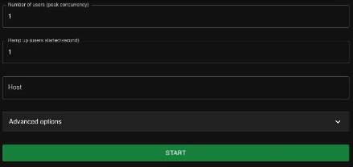
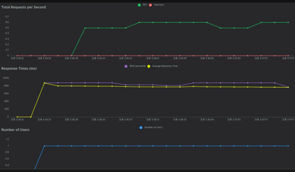
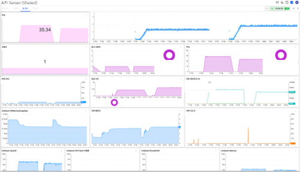
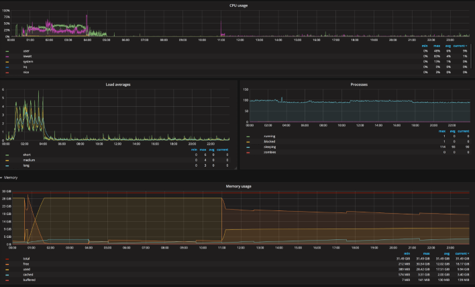

# Sample_Performance_Locust

> ⚠️ **본 프로젝트는 포트폴리오용으로 제작된 샘플입니다.**
>
> 실무에서 진행한 API 성능(부하) 테스트 작업을 바탕으로 재구성했으며,
> 보안 및 개인정보 보호를 위해 서버 주소, API 엔드포인트 경로, 파라미터명, 로컬 경로, 테스트 이미지 등
> 민감한 정보는 모두 제거하거나 임의의 값(`xxx`, `api-01` 등)으로 대체했습니다.
> 따라서 이 저장소의 코드는 실제 서버에 연결되어 동작하지 않습니다.

## 개요

이미지 업로드(multipart/form-data) 방식의 API 서버를 대상으로 **Python + Locust**를 이용해 성능(부하) 테스트를 수행한 프로젝트입니다.

- 가상 사용자(User)가 동시에 API를 호출하는 부하 시나리오 작성
- 테스트 시작 시(`on_start`) 이미지를 한 번만 읽어 메모리에 올려 두고, 매 요청마다 재사용하여 파일 I/O가 측정 결과에 영향을 주지 않도록 구성
- 응답 Status Code 검증 및 응답 값 검증(Assertion)으로 부하 상황에서의 정상 응답 여부 확인
- Locust Web UI에서 RPS, 응답 시간(평균/백분위), 실패율을 모니터링

## 기술 스택

| 구분 | 사용 도구 |
|---|---|
| 언어 | Python |
| 성능 테스트 | Locust |

## 프로젝트 구조

```
Sample_Performance_Locust/
├── README.md
├── images/             # Locust 수행 시 필요한 테스트 이미지 저장 폴더 (이미지는 저장소에서 제외)
│   └── README.md
└── scripts/
    └── locustfile.py   # Locust 부하 테스트 시나리오 (엔드포인트는 /api-01로 익명화)
```

## 테스트 시나리오

```python
class MyUser(HttpUser):
    wait_time = between(1, 1)            # 각 User는 요청 간 1초 대기

    def on_start(self):
        # User 시작 시 이미지를 한 번만 읽어 둠
        with open("./images/sample.jpg", "rb") as file:
            self.image_data = file.read()

    @task
    def api_request(self):
        files = {"image": ("sample.jpg", self.image_data, "image/jpeg")}
        response = self.client.post("/api-01", files=files)
        assert response.status_code == 200
```

## 테스트 실행 및 모니터링

부하는 Locust로 발생시키고, 부하가 걸리는 동안 서버 상태는 APM(WhaTap)과 Grafana로 함께 모니터링했습니다.
클라이언트 쪽 지표(RPS, 응답 시간)와 서버 쪽 지표(TPS, CPU/GPU, 메모리)를 함께 보며 병목 구간을 확인했습니다.

### 1. Locust 부하 설정



Locust Web UI에서 부하 조건을 설정한 뒤 테스트를 시작합니다.

- **Number of users**: 동시에 요청을 보내는 가상 사용자 수 (최대 동시 접속 수)
- **Ramp up**: 초당 새로 시작하는 사용자 수. 부하를 한 번에 주지 않고 단계적으로 높일 때 사용합니다.
- **Host**: 테스트 대상 서버 주소

### 2. Locust 테스트 결과



Locust가 실시간으로 보여 주는 클라이언트 쪽 성능 지표입니다.

- **Total Requests per Second**: 초당 처리된 요청 수(RPS)와 실패 수. 테스트 동안 실패(Failures)가 0인 것을 확인했습니다.
- **Response Times (ms)**: 평균 응답 시간과 95th percentile 응답 시간. 부하가 유지되는 동안 응답 시간이 일정하게 유지되는지 확인했습니다.
- **Number of Users**: 시간에 따른 가상 사용자 수 변화

### 3. APM 모니터링 (WhaTap)



부하가 걸리는 동안 애플리케이션과 서버 상태를 APM 대시보드로 확인했습니다.

- **TPS / 동시 사용자 / 응답 시간**: 서버 쪽에서 측정한 처리량과 응답 시간을 Locust 결과와 비교
- **CPU / 메모리 / 디스크 / 네트워크 I/O**: 부하 구간에서 서버 리소스 사용량 변화 확인
- **GPU 사용률 / GPU 메모리 (nvidia-smi)**: 이미지 처리 API 특성상 GPU 사용량을 함께 확인해, 부하가 늘어날 때 GPU가 병목이 되는지 점검

### 4. 서버 리소스 모니터링 (Grafana)



Grafana 대시보드로 테스트 전후를 포함한 긴 시간 동안의 서버 리소스 추이를 확인했습니다.

- **CPU usage**: user / iowait / system 등 항목별 CPU 사용률
- **Load averages**: 1분 / 5분 / 15분 평균 부하
- **Processes**: 실행 중(running) / 대기(blocked) 프로세스 수
- **Memory usage**: total / free / used / cached / buffered 메모리 추이. 테스트가 끝난 뒤 메모리가 정상적으로 반환되는지(누수 여부) 확인했습니다.

## 실행 방법

```bash
pip install locust

# 테스트 이미지 준비 (개인정보 보호를 위해 저장소에는 포함하지 않음)
mkdir images && cp <your_image>.jpg images/sample.jpg

# Web UI 모드 실행 → http://localhost:8089 에서 User 수 / Spawn rate 설정 후 시작
locust -f scripts/locustfile.py --host https://xxx.example.com

# Headless 모드 실행 예시 (User 50명, 초당 5명씩 증가, 5분간)
locust -f scripts/locustfile.py --host https://xxx.example.com --headless -u 50 -r 5 -t 5m --html report.html
```
